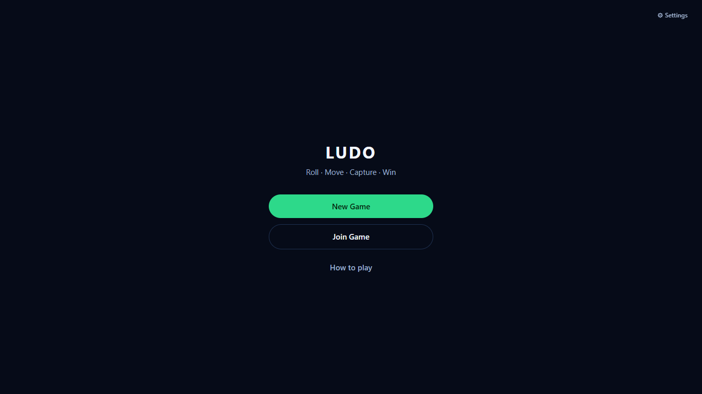
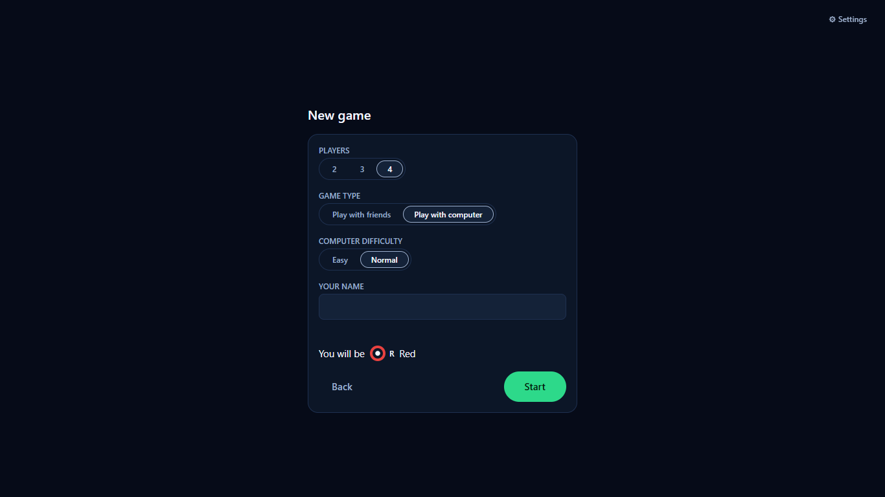
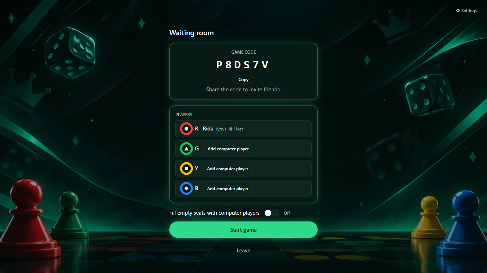
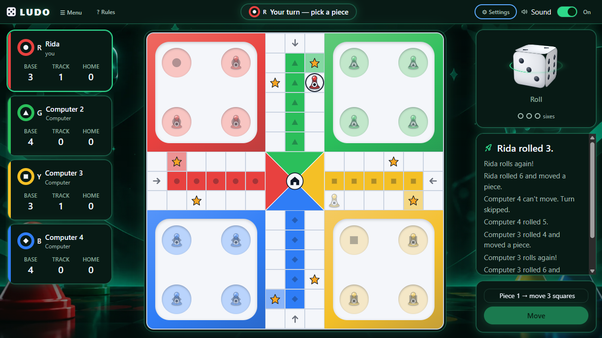
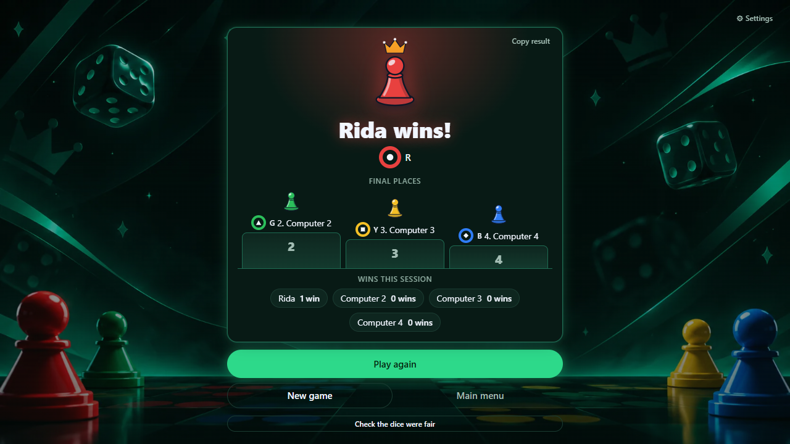
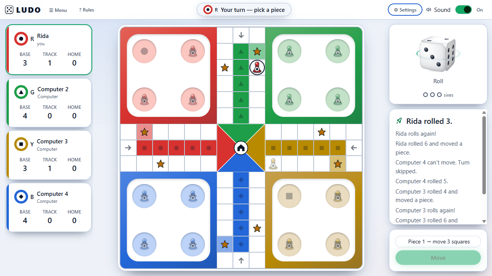
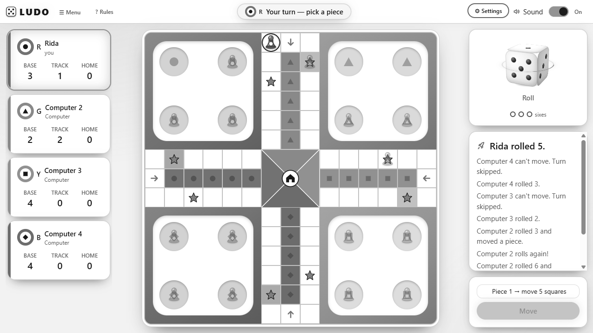
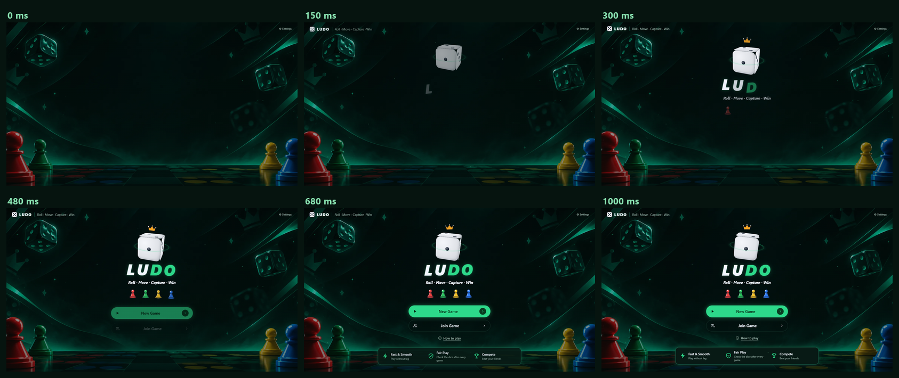
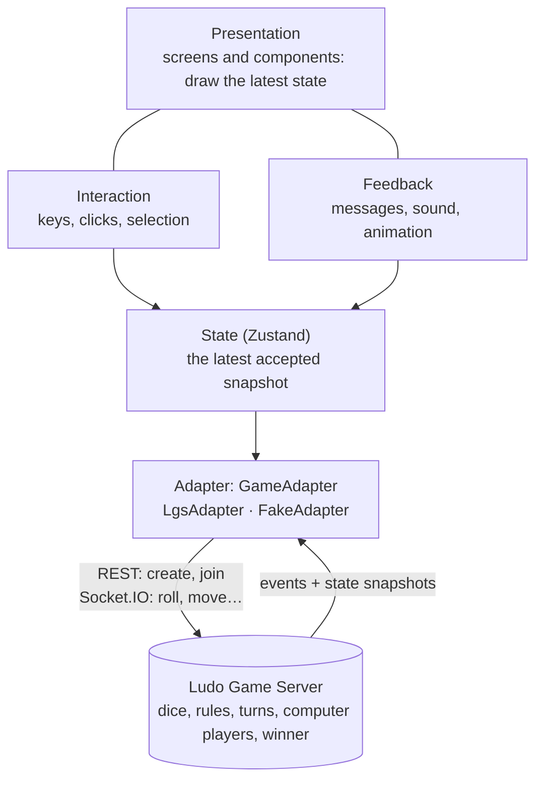
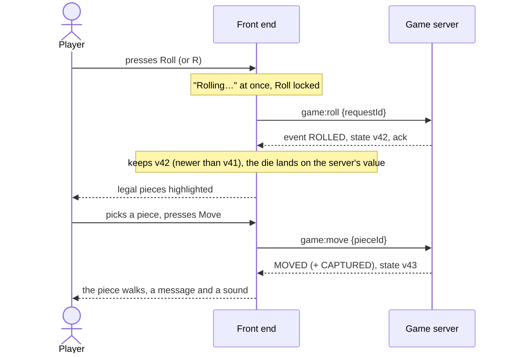

<div align="center">

# 🎲 Ludo: Online Board Game Front End

### A fair, accessible Ludo game for the browser, built with React, TypeScript and Socket.IO

[](https://github.com/HifzaZia-hub/ludo-frontend-powerpuffgirls/actions/workflows/checks.yml)


[Screenshots](#-screenshots) • [Run it](#-getting-started) • [How it works](#-how-it-works) • [Requirements](docs/00-requirements.md) • [Traceability](docs/05-traceability.md)



</div>

---

## 📋 Table of contents

- [About](#-about)
- [Features](#-features)
- [Screenshots](#-screenshots)
- [Tech stack](#-tech-stack)
- [Getting started](#-getting-started)
- [How to play](#-how-to-play)
- [Scripts](#-scripts)
- [How it works](#-how-it-works)
- [Project structure](#-project-structure)
- [Testing](#-testing)
- [Documentation](#-documentation)
- [Team](#-team)
- [Licence](#-licence)

---

## 🎯 About

This is the **browser front end of a multiplayer Ludo game**, built by team **Power Puff Girls** for Software Engineering, Fall 2026. Play against the computer or invite friends with a six-letter game code, and play with the mouse or the keyboard alone.

The game server is the referee. It rolls the dice, knows the rules, works out the legal moves, runs the computer players and decides the winner. This app never decides any of that. It sends the player's requests, shows the latest state the server accepted, explains in plain words when the server says no, and animates between two accepted states. That keeps every player's screen in agreement and makes cheating from the browser impossible.

What we had to build is set out in our own requirements, [D2](docs/d2/D2.pdf) and [D3](docs/d3/D3_v1.1.pdf): ten functional requirements (FR-SYS-01 to 10) and fourteen non-functional ones (NFR-SYS-01 to 14). [`docs/05-traceability.md`](docs/05-traceability.md) links each one to its code and its proof.

---

## ✨ Features

<table>
<tr>
<td width="50%" valign="top">

**🎮 Play your way**
- 2, 3 or 4 players, against the computer (Easy or Normal) or with friends
- Waiting room with a six-letter game code to share
- Pick your colour; the others follow clockwise
- Restart, leave or play again, always behind an "Are you sure?" with Cancel focused

</td>
<td width="50%" valign="top">

**⚖️ Fair and clear**
- The die only ever shows the server's roll, and a dice check on the win screen proves the rolls were fixed before the game began
- Only the pieces the server allows can be picked, with the landing square previewed
- Pieces walk square by square; captures, finishes and extra turns are explained in the message log
- Base, Track and Home counts for every player

</td>
</tr>
<tr>
<td width="50%" valign="top">

**♿ Accessible**
- A whole game can be played with the keyboard alone
- Every player has a letter and a shape as well as a colour, so the game works without colour vision
- All text meets WCAG AA contrast in every theme
- Short, friendly wording, and a rules summary built from the server's own rules
- Animations On, Fast or Off, and the device's reduced-motion setting is respected

</td>
<td width="50%" valign="top">

**💎 Polished and robust**
- Five themes: emerald Dark, Light, Neon, Forest and Minimal
- Micro-animations, an interactive 3D die on the front page and an optional 3D game die
- Sound effects made by our own script, and confetti on a win
- Survives a refresh, a lost connection and a second tab without losing the game
- Fits any window from a small phone to a 1920 × 1080 screen

</td>
</tr>
</table>

---

## 📸 Screenshots

| Setup | Waiting room |
|:---:|:---:|
|  |  |
| **Game** | **Win** |
|  |  |

<details>
<summary><b>More: light theme, no colour vision, motion</b></summary>

<br>

**Light theme**



**With colour vision turned off:** players are still told apart by letter and shape.



**The front page coming in**, frozen at six moments.



</details>

---

## 🛠️ Tech stack

| Area | What we use |
|---|---|
| **Language** | TypeScript 5.8 in strict mode, with TSX for the React components |
| **Interface** | React 18, Tailwind CSS 3 with theme colours as CSS variables, Framer Motion 11 |
| **State** | Zustand 5: one store holds the latest snapshot the server accepted |
| **Server connection** | REST for creating and joining rooms, socket.io-client 4 for the live game |
| **Extras** | howler (sound), canvas-confetti, three and @react-three/fiber (the optional 3D die, loaded only when switched on) |
| **Build** | Vite 6 |
| **Testing** | Vitest 3, Testing Library and jsdom, plus a no-library browser script that drives Chrome, Edge or Firefox |
| **Quality** | ESLint 9 (including a rule against `Math.random`), Prettier, GitHub Actions |
| **Mock server** | Express 5 and socket.io 4, speaking the same protocol as the real game server |

---

## 🚀 Getting started

### Prerequisites

- **Node.js 22 or later** (CI uses Node 24) and **npm**
- Chrome, Edge or Firefox

### Installation

1️⃣ **Clone the repository**

```bash
git clone https://github.com/HifzaZia-hub/ludo-frontend-powerpuffgirls.git
cd ludo-frontend-powerpuffgirls
```

2️⃣ **Install the dependencies**

```bash
npm install
```

3️⃣ **Set the game server's address**

```bash
cp .env.example .env
```

`.env` holds one setting, `VITE_SERVER_URL`. The example points at the mock server on `http://localhost:3001`. To use the real game server, change it to that server's address.

4️⃣ **Start the mock server and the app**, each in its own terminal

```bash
npm run mock
```

```bash
npm run dev
```

🎉 Open the address Vite prints, usually <http://localhost:5173>.

> **On Windows,** if PowerShell says scripts are disabled, use `npm.cmd` in place of `npm` (for example `npm.cmd run dev`).

---

## 🎮 How to play

Press **New Game**, choose **Play with computer**, type a name, pick a colour and press **Start**. Roll the die, pick one of the highlighted pieces and press **Move**. The first player to bring all four pieces home wins.

| Key | What it does |
|---|---|
| `R` | Roll the die |
| `1`–`4` | Pick that piece |
| `Enter` | Move the picked piece |
| `S` | Skip the animation |
| `?` | Open the rules |
| `Esc` | Close a window, or cancel the piece you picked |

The rules the server plays by: a piece leaves its base only on a 6, a 6 gives another turn and three 6s in a row lose it, landing on an opponent sends it home, start and star squares are safe, and an exact roll is needed to finish. **How to play** on the front page shows the rules of the game you are in.

---

## 📜 Scripts

| Script | What it does |
|---|---|
| `npm run dev` | Starts the app with live reload |
| `npm run build` | Type-checks, then builds to `dist/` |
| `npm run preview` | Serves the built app |
| `npm run typecheck` | Runs the TypeScript checks (app and mock server) |
| `npm run lint` | Runs ESLint |
| `npm run format` | Formats the code with Prettier |
| `npm test` | Runs all the tests once |
| `npm run mock` | Starts the mock game server on port 3001 |
| `npm run mock:debug` | The same, plus `/debug` routes to force rolls, set up scenes such as a near win, and change rules |
| `npm run e2e -- <mode>` | Plays real games in a real browser; see [Testing](#-testing) |

---

## 🏗️ How it works

The app is built in layers (our D3, section 3.2). Each has one job, and only the adapter talks to the server, so the server can be swapped (real, mock or a fake for tests) without touching the screens.



One turn, from the press to the piece moving:



Rules the code keeps:

- **Never decide a rule.** No dice value, legality, capture, turn, winner or score is worked out in the browser.
- **One source of truth.** Only the latest snapshot is stored; everything else (whose turn, which pieces can move) is a selector.
- **Versions.** A snapshot is kept only if it is newer; a gap triggers `state:sync`.
- **Never move first.** A piece moves only after the server accepts, and a refused request changes nothing.
- **Only the adapter goes out.** Nothing outside `src/adapter/` may use Socket.IO or `fetch`.

The full protocol is in [`docs/01-contract.md`](docs/01-contract.md).

---

## 🗂️ Project structure

```text
ludo-frontend-powerpuffgirls/
├── src/
│   ├── screens/        # Main, Setup, Lobby, Game, Win, Stopped, Rejoining, Rules, Settings
│   ├── components/     # Board, Piece, Pawn, Dice, PlayerCard, MessageLog, Button, ConfirmDialog…
│   ├── interaction/    # keyboard keys, move selection, walking, navigation
│   ├── feedback/       # message templates, friendly wording, sound, animation timings
│   ├── store/          # gameStore (the snapshot and commands), settingsStore, uiStore
│   ├── adapter/        # GameAdapter, LgsAdapter (the server), FakeAdapter (tests)
│   ├── config/         # board geometry, players' colours, letters and shapes
│   ├── contract/       # types copied from the server's contract, no logic
│   └── styles/         # theme.css: the five themes, the 3D die, animations
├── mock-server/        # our stand-in game server (Express + Socket.IO)
├── scripts/            # e2e.mjs (browser checks), make-sounds.py (the sound effects)
├── public/sounds/      # sprite.wav, all six sounds in one file
├── docs/               # requirements, contract, build plan, traceability, evidence
└── .github/workflows/  # checks.yml: the checks GitHub runs on every pull request
```

---

## 🧪 Testing

- **Unit and component tests** (Vitest): run with `npm test`. The store is tested against `FakeAdapter`, with no network, to prove for example that a refused move changes nothing and that an old snapshot is ignored.
- **Mock server tests:** its rules, its rooms, and whole games over real sockets.
- **Browser checks:** `npm run e2e -- <mode>` starts the mock, the app and a real browser on ports of its own, then plays. Modes: `smoke`, `keyboard`, `games`, `sizes`, `grayscale`, `contrast`, `themes`, `die3d`, `colours`, `motion`, `perf`, `invalid`, `boundary`. Add `--browser edge` or `--browser firefox`, and `--save` to write screenshots into `docs/evidence/`.
- **On every pull request** GitHub Actions runs typecheck, lint, build, all the tests and the browser smoke test.

Some measured results: every press shows a response by the next frame (35 ms at worst), the slowest computer turn in a whole game took 1.7 s, and start, roll, move and win pass in Chrome, Edge and Firefox. [`docs/05-traceability.md`](docs/05-traceability.md) has every result and where it came from.

---

## 📚 Documentation

| Document | What it covers |
|---|---|
| [`docs/00-requirements.md`](docs/00-requirements.md) | What we must build: personas, rules, FR-SYS-01…10, NFR-SYS-01…14 |
| [`docs/01-contract.md`](docs/01-contract.md) | How the app talks to the game server |
| [`docs/02-board-model.md`](docs/02-board-model.md) | How a piece's step becomes a square on the board |
| [`docs/03-ui-spec.md`](docs/03-ui-spec.md) | Screens, colours, keys and wording |
| [`docs/04-build-plan.md`](docs/04-build-plan.md) | The tasks, P0 to P14, in build order |
| [`docs/05-traceability.md`](docs/05-traceability.md) | Each requirement, its code, and its proof |
| [`docs/06-d3-v1.1-changes.md`](docs/06-d3-v1.1-changes.md) | What changed between D3 v1.0 and v1.1 |
| [`docs/07-demo-script.md`](docs/07-demo-script.md) | A 10-minute demo, step by step |
| [`docs/evidence/`](docs/evidence/) | Screenshots and notes behind each result |
| [`docs/d1`](docs/d1/D1.pdf) · [`docs/d2`](docs/d2/D2.pdf) · [`docs/d3`](docs/d3/D3_v1.1.pdf) | Our course deliverables |

**Project management:** [meeting notes](docs/meetings/), [Trello board](docs/trello/), [burndown chart](docs/burndown.md), [wireframes](docs/wireframes/) and [requirement notes](docs/requirements/).

---

## 👥 Team

**Power Puff Girls**, Software Engineering, Fall 2026:

- **Zainab Tariq**
- **Saneela Aziz**
- **Hifza Zia**

We work in short branches, each merged through a pull request that GitHub checks first. Commit messages name the requirement they serve, for example `feat(dice): show server roll value (FR-SYS-02)`.

The game server is built by the backend team to the contract in [`docs/01-contract.md`](docs/01-contract.md).

---

## 📄 Licence

This is a university course project, and no open-source licence has been added yet.

<div align="center">

<br>

**Ludo** • made by team Power Puff Girls

</div>
