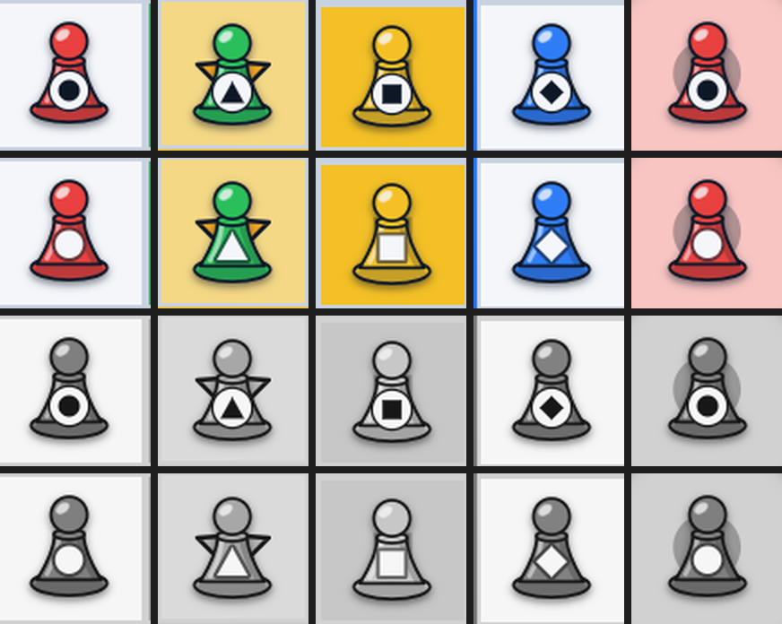

# The pawn's emblem (NFR-SYS-07)

Each pawn on the board carries its player's shape, so pieces are told apart without colour. Until
2026-11-23 the shape was a black symbol on a white sticker. At board size that read as a target or
a warning sign and clashed with the rest of the board, so the team asked for it to look better.

Now the shape is printed straight on the pawn's body in white, outlined in a deeper shade of the
pawn's own colour, with a soft shadow below it (`src/components/Pawn.tsx`). The white stands out
on the red, green and blue bodies; the outline carries it on yellow, which is light, and in
grayscale. It is also a little larger than the old symbol (7.4 units across on the pawn's 24, was
5.7).

Rows, top to bottom: before, after, before in grayscale, after in grayscale. Columns: a red pawn
(circle), a green one on a safe square (triangle), a yellow one in its home column (square), a blue
one (diamond), and a red one in its yard.

Checked:

- `src/components/Pawn.test.tsx`: every colour's pawn prints its own shape, the shape is light, not
  a dark mark, and it is left off only when asked.
- `npm run e2e -- grayscale --save`: the game and win screens retaken with colour vision turned
  off (`NFR-SYS-07-game-*.png`, `NFR-SYS-07-win-*.png`), all four shapes readable.
- `npm run e2e -- themes --save`: the game screen retaken in every theme.
- `npm run e2e -- contrast`: no text changed, and none falls below the target.

The marks beside names (`PlayerMark`) keep their shape and letter as before.
